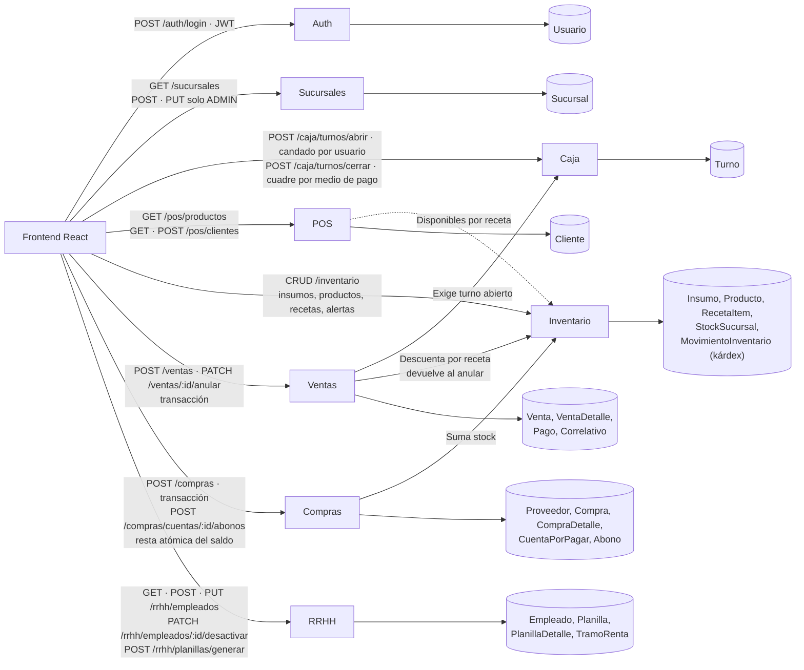

# Orígenes SV · ERP y POS

Proyecto de cátedra de Programación Web, ciclo 02-2026. Caso de negocio 1: ERP y POS para "Restaurante Orígenes SV", una cadena de cafeterías con varias sucursales. El sistema cubre la venta en caja, el inventario con descuento por receta, las compras a proveedores, el cierre de turno y la planilla de los empleados.

Desarrollado por el equipo **Nexo Bytecode**.

## Integrantes

| Nombre | Carnet | Módulo |
| --- | --- | --- |
| Saul Ernesto Giron Vigil | 00033325 | Líder, base del proyecto y autenticación |
| Rodrigo Josué Medrano Márquez | 00148625 | POS y diseño de la interfaz |
| Magaly Brendalí Aguilar Granillo | 00209425 | Ventas y facturación |
| Andrés Eduardo Vega Mena | 00077125 | Inventario y recetas |
| Johann André Angel Menjívar | 00071625 | Compras y proveedores |
| Amy Ariadna Barraza Villacorta | 00012725 | Caja y turnos |
| Alfredo Antonio Guarita Hernández | 00155425 | RRHH y planilla |
| Daniel Alexander Avelar Orellana | 00089625 | QA, documentación y despliegue |

## Arquitectura



Todas las rutas, excepto `POST /api/auth/login` y `GET /api/health`, requieren token JWT. Cada ruta llega a su módulo, que valida el rol, aplica las reglas de negocio y guarda en PostgreSQL por medio de Prisma. Inventario es el centro del flujo de stock: el POS lo consulta para saber cuántas unidades alcanzan, Ventas descuenta por receta y devuelve al anular, y Compras suma stock. Todas las tablas viven en una sola base de datos PostgreSQL.

## Estructura

```
proyecto-final-PW-Nexo-Bytecode/
├── backend/            API REST (Express + Prisma)
│   ├── prisma/         Esquema, migraciones y datos de prueba (seed)
│   └── src/modules/    Un módulo por área: auth, pos, ventas, inventario,
│                       compras, caja, rrhh, sucursales
├── frontend/           Aplicación web (React + Vite + Tailwind)
│   └── src/pages/      Una carpeta de pantallas por módulo
└── docs/               Documentación de la API, base de datos y manual
```

## Tecnologías

- **Backend:** Node.js, Express 5, Prisma 6, PostgreSQL, JWT y bcryptjs
- **Frontend:** React 19, Vite, React Router, Axios y Tailwind CSS 4

## Módulos

| Módulo | Qué hace | Roles |
| --- | --- | --- |
| Dashboard | Resumen del día: ventas, total vendido, alertas de stock y estado de la caja | Todos |
| POS | Toma pedidos, cobra con efectivo, tarjeta, Bitcoin o Chivo Wallet (también combinados) y emite Consumidor Final o Crédito Fiscal | Admin, Gerente, Cajero |
| Ventas | Historial de ventas, vista del comprobante y anulación | Admin, Gerente, Cajero |
| Inventario | Insumos con stock por sucursal, productos con receta y alertas de stock mínimo | Admin, Gerente |
| Compras | Proveedores, facturas de compra, cuentas por pagar y abonos | Admin, Gerente |
| Caja | Apertura y cierre de turno con cuadre de efectivo | Admin, Gerente, Cajero |
| RRHH | Empleados por sucursal y planilla con ISSS, AFP y renta | Admin, Gerente |

Al vender un producto elaborado se descuentan sus insumos según la receta. Por ejemplo, un Latte Grande descuenta 18 g de café, 250 ml de leche, un vaso de 16 oz, la tapadera y la viñeta. Al registrar una compra el stock sube y, si es a crédito, se crea la cuenta por pagar.

## API

Todas las rutas empiezan con `/api` y, salvo el login, piden el token en el encabezado `Authorization: Bearer <token>`.

| Prefijo | Rutas principales |
| --- | --- |
| `/auth` | `POST /login`, `GET /me` |
| `/pos` | `GET /categorias`, `GET /productos`, `GET` y `POST /clientes` |
| `/ventas` | `POST /`, `GET /`, `GET /:id`, `PATCH /:id/anular` |
| `/inventario` | CRUD de `/insumos` y `/productos`, `PUT /productos/:id/receta`, `GET /alertas` |
| `/compras` | CRUD de `/proveedores`, `GET /proveedores/:id/estado-cuenta`, `GET /cuentas`, `POST /cuentas/:id/abonos`, `GET` y `POST /` |
| `/caja` | `POST /turnos/abrir`, `GET /turnos/actual`, `POST /turnos/cerrar` |
| `/rrhh` | CRUD de `/empleados`, `GET /planillas`, `POST /planillas/generar`, `PATCH /planillas/:id/pagar` |
| `/sucursales` | `GET /`, `GET /:id`, `POST /` y `PUT /:id` (solo Admin) |

El detalle de cada ruta, con lo que recibe y lo que responde, está en [docs/api.md](docs/api.md).

**Puertos:** backend `3000`, frontend `5173`.

## Instalación y ejecución

**Requisitos:** [Node.js](https://nodejs.org/) 20 o superior y [PostgreSQL](https://www.postgresql.org/) 17 o superior.

### 1. Clonar e instalar

```bash
git clone https://github.com/saul-ing/proyecto-final-PW-Nexo-Bytecode.git
cd proyecto-final-PW-Nexo-Bytecode
git checkout develop
npm run install:all
```

### 2. Configurar las variables de entorno

```bash
cp backend/.env.example backend/.env
cp frontend/.env.example frontend/.env
```

En `backend/.env`, reemplazar `TU_PASSWORD` por la contraseña del usuario `postgres`. El archivo del frontend no requiere cambios.

### 3. Crear la base de datos y cargar los datos de prueba

```bash
npm run db:migrate
npm run db:seed
```

La migración crea la base `origenes_erp` si no existe. El seed carga 3 sucursales, usuarios de prueba, 26 insumos, 19 productos, clientes, proveedores con compras y empleados. Se puede correr varias veces sin duplicar datos.

### 4. Levantar el backend y el frontend

Ejecutar cada servicio en una terminal distinta:

```bash
npm run dev:backend
```

```bash
npm run dev:frontend
```

La aplicación queda disponible en http://localhost:5173.

### Usuarios de prueba

| Rol | Correo | Contraseña |
| --- | --- | --- |
| Administrador | admin@origenes.sv | Admin123! |
| Gerente | gerente@origenes.sv | Gerente123! |
| Cajero | cajero@origenes.sv | Cajero123! |
| Barista | barista@origenes.sv | Barista123! |

## Entregables

- [Investigación IEEE (PDF)](docs/ieee/informe.pdf) y su [fuente LaTeX](docs/ieee/informe.tex)
- [Confirmación individual de uso de IA](docs/ieee/uso-ia.md)
- [Seguimiento de actividades de los integrantes (Excel)](docs/qa/seguimiento.xlsx)
- [Manual de usuario](docs/manual-usuario.md)

## Documentación técnica

- [Arquitectura](docs/arquitectura.md)
- [API](docs/api.md): rutas, lo que reciben y lo que responden
- [Base de datos](docs/db.md): modelo y seed
- [Despliegue local](docs/despliegue-local.md)
- [Plan de pruebas](docs/qa/plan-pruebas.md), [verificación](docs/qa/verificacion.md), [matriz de requisitos](docs/qa/matriz-requisitos.md) e [incidencias](docs/qa/incidencias.md)

Las pruebas automáticas de contrato HTTP se ejecutan con `npm run qa:test` y no requieren base de datos.

## Flujo de trabajo

El proyecto sigue Git Flow. `main` contiene la versión estable y `develop` la de integración. Cada integrante trabaja en una rama `feature/<modulo>` o `fix/<tema>` que sale de `develop` y se integra mediante Pull Request. No se hace push directo a `main` ni a `develop`.

Los commits llevan gitmoji y el formato `tipo(modulo): descripción`, por ejemplo `✨ feat(compras): registrar abonos a cuentas por pagar`.
