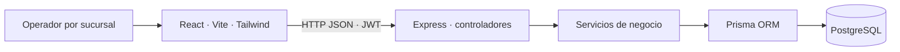

# Arquitectura

Referencia de implementación: `develop`, commit `3575d81`.

La interfaz monta inicio de sesión, panel, POS, ventas, inventario, compras, caja y RR. HH. Las rutas y el menú usan el rol para habilitar módulos. El cliente Axios compartido adjunta el token y devuelve la sesión al login ante una respuesta 401 de un módulo. La API valida el token; las reglas de sucursal y de rol se aplican en los módulos correspondientes.

| Capa | Ubicación | Responsabilidad |
|---|---|---|
| Interfaz | `frontend/src/pages`, `routes`, `api` | Formularios, navegación, solicitudes y presentación de errores |
| API | `backend/src/routes.js`, `backend/src/modules` | Rutas, validación y servicios por módulo |
| Persistencia | `backend/prisma` | Esquema, migraciones y datos de demostración |
| Entrega y QA | `docs` | Guía de arranque, manual, trazabilidad y verificación |

Ventas agrupa correlativo, descuento de existencias, kárdex y creación de la venta en una transacción. El control de inventario usa stock por insumo y sucursal. Una compra registra su detalle, entrada de inventario y cuenta por pagar cuando corresponde. Caja calcula las diferencias por medio de pago; RR. HH. aplica las deducciones y el tramo de renta de la quincena.

Véanse los [contratos HTTP](api.md), el [modelo de datos](db.md), la [guía de despliegue](despliegue-local.md) y la [verificación](qa/verificacion.md).
