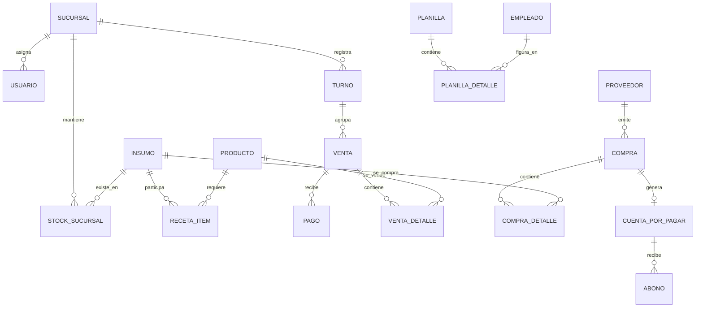

# Base de datos

El esquema de `backend/prisma/schema.prisma` usa PostgreSQL. La verificación se ejecutó con PostgreSQL 18. Las migraciones versionadas viven en `backend/prisma/migrations`.

`StockSucursal` identifica cada existencia por el par insumo y sucursal. Los elaborados tienen líneas en `RecetaItem`; la reventa usa un insumo asociado. Los movimientos de inventario guardan su tipo y referencia. Los correlativos de venta distinguen sucursal y tipo de comprobante. `TramoRenta` almacena los rangos, porcentajes, bases y cuotas fijas que consulta el cálculo de nómina.

## Seed principal

Desde `backend`, `npm run db:seed` ejecuta `prisma/seed.js`. El orden de carga es:

1. **Base:** Casa Matriz, Santa Tecla y San Miguel, con cuatro cuentas de demostración asociadas a Casa Matriz.
2. **Inventario:** categorías, insumos, stock y ajustes iniciales por sucursal, 15 elaborados con receta y cuatro productos de reventa.
3. **Clientes:** registros de demostración con datos fiscales para emitir CCF.
4. **Compras:** proveedores, compras de contado y crédito, cuentas en distintos estados y abonos de ejemplo.
5. **RR. HH.:** empleados de las tres sucursales, asociaciones con usuarios y tramos quincenales de renta.

Para levantarlo desde cero, sigue la [guía de despliegue](despliegue-local.md).
