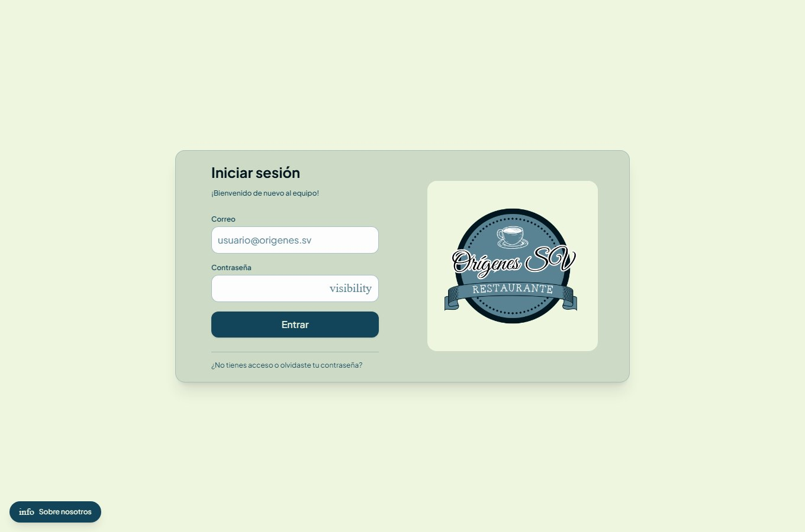
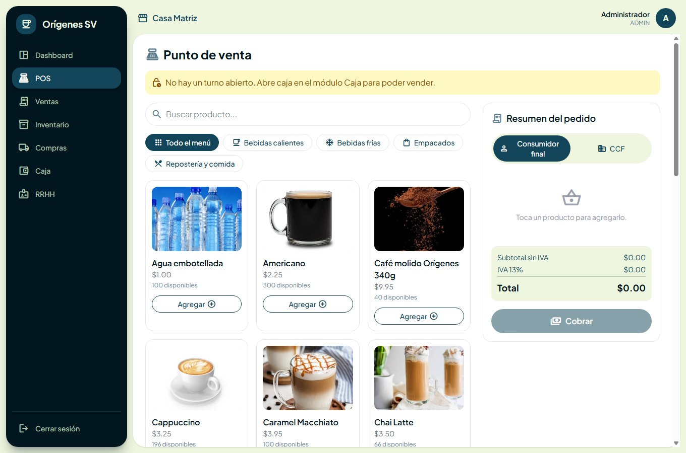
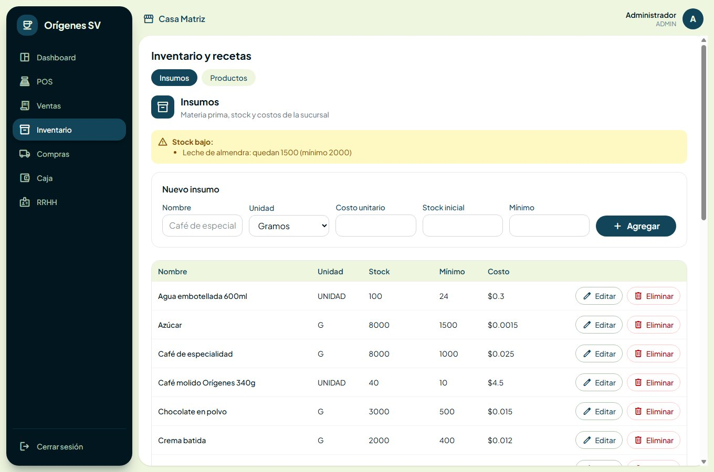
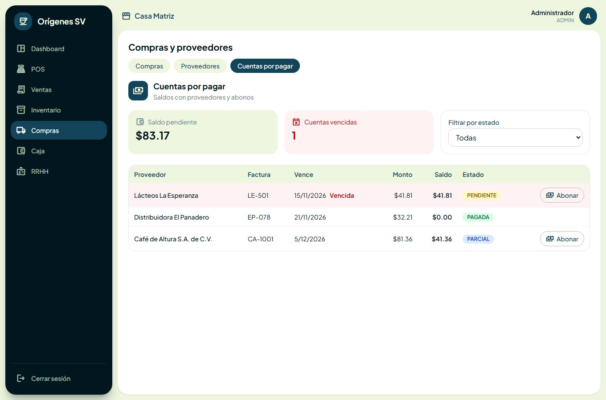
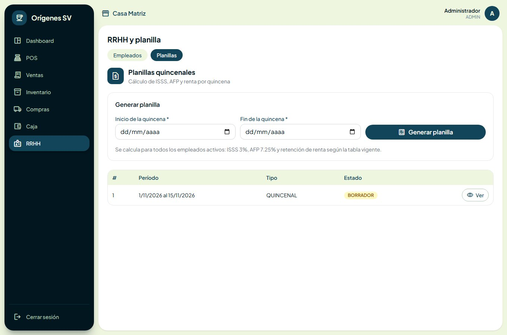

# Manual de usuario

Esta guía muestra la versión integrada de `develop` (`5c17615`). Las capturas se tomaron en Chrome sobre una base de demostración cargada con el seed principal.

## Iniciar sesión

1. Abre la URL del sistema y entra con la cuenta que te asignaron.
2. En el panel inicial, selecciona un módulo del menú. Las opciones visibles dependen de tu rol. Caja y Ventas están disponibles para administración, gerencia y caja. Inventario, Compras y RRHH se muestran a administración y gerencia.

## Cuentas de demostración

Estas cuentas las crea el seed en Casa Matriz. Úsalas en la instalación local de prueba.

| Usuario | Contraseña inicial de demo | Rol | Módulos para la demostración |
|---|---|---|---|
| `admin@origenes.sv` | `Admin123!` | ADMIN | POS, ventas, caja, inventario, compras y RR. HH. |
| `gerente@origenes.sv` | `Gerente123!` | GERENTE | POS, ventas, caja, inventario, compras y RR. HH. |
| `cajero@origenes.sv` | `Cajero123!` | CAJERO | POS, ventas y caja. |
| `barista@origenes.sv` | `Barista123!` | BARISTA | Solo ve el panel inicial con el resumen del día. |

## Abrir caja, cobrar y cerrar

1. En **Caja**, abre un turno e indica el efectivo inicial.
2. En **POS**, busca un producto por nombre o filtra por categoría. Agrégalo al carrito y ajusta las cantidades de acuerdo con las existencias.
3. Selecciona **CF** o **CCF**. Para CCF, selecciona el cliente correspondiente. Revisa el total y elige **Cobrar**.
4. Registra los importes por medio de pago y confirma. En **Ventas**, busca la operación y abre el comprobante.
5. Al finalizar el turno, vuelve a **Caja**, revisa los importes esperados y registra los valores del recuento para consultar el cuadre.

## Gestionar inventario y compras

- **Inventario → Insumos** permite consultar existencias y alertas, además de registrar insumos con su unidad y mínimo.
- **Inventario → Productos** permite gestionar elaborados y reventa. En la receta de un elaborado, registra los insumos y las cantidades necesarias para una unidad. Guardar la receta reemplaza sus líneas anteriores.
- **Compras → Proveedores** permite consultar proveedores y abrir su estado de cuenta. En **Compras**, registra una factura con sus insumos. En **Cuentas por pagar**, consulta saldos y registra los pagos que correspondan.

## Gestionar empleados y planillas

1. En **RRHH → Empleados**, registra los datos del empleado, cargo, salario, fecha de ingreso y sucursal.
2. En **RRHH → Planillas**, selecciona el período y genera la planilla. Revisa el detalle antes de usar el resultado en un proceso administrativo.

Si POS indica que falta un turno abierto, ve a Caja y regresa al catálogo. Si el módulo no figura en el menú, verifica el rol con el administrador. Registra incidencias con la pantalla, el paso y el mensaje mostrado, sin incluir contraseñas ni datos personales.
